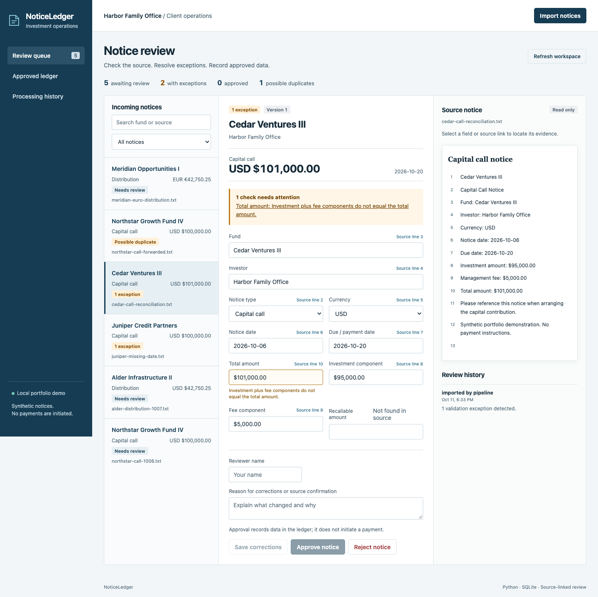

# NoticeLedger
[](https://github.com/tanishq-eradala/noticeledger/actions/workflows/ci.yml)

NoticeLedger is a private-investment data operations prototype using Python, SQLite and a browser review interface. It is not affiliated with Arch, and its demo contains synthetic notices with no payment instructions.

The workflow is deliberately narrow: acquire a capital-call or distribution notice, extract candidate values with source evidence, validate them, resolve exceptions, and record an approved cash flow. The field selection is informed by [ILPA's capital-call and distribution template](https://ilpa.org/industry-guidance/templates-standards-model-documents/ilpa-templates-hub/ilpa-capital-call-distribution-template/). This is a simplified model, not an implementation of the full ILPA standard.

## What works

- Text import, multiline CSV batches and selectable-text PDFs. Original PDF bytes and extracted text are retained.
- Repeatable folder acquisition through `ingest.py`, with a JSON run report, per-file failures and safe deduplication across repeated runs.
- Rule-based extraction for fund, investor, notice type, currency, notice date, due/payment date, total amount, investment and fee components, and recallable distributions.
- Field-level evidence containing the exact original line and value. Source text and original extracted values remain immutable when corrections are made.
- Decimal parsing into integer cents. Invalid grouping, extra decimal places, exponent notation and negative totals are rejected rather than rounded or guessed.
- Checks for required fields, supported currencies, currency symbols, conflicting source values, date ordering, total-versus-components reconciliation and recallable-amount bounds.
- SHA-256 source deduplication plus a normalized business fingerprint. Equivalent transactions with different source text are held for investigation.
- Human review with named reviewers, correction/rejection reasons, version checks, an audit history and explicit approval confirmation.
- Transactional approval inserts a unique ledger entry and records the review together. Retrying an approval after its response is lost cannot insert a second cash flow.
- CSV export includes only approved entries, preserves exact cents and escapes spreadsheet formula prefixes in imported entity names.
- SQL reporting separates net flows by currency. There is no foreign-exchange conversion, payment execution or assertion that notice amounts are bank-settled cash flows.
- Durable processing records, extraction failures, local diagnostic timing and Prometheus-format monitoring at `/metrics`.
- Responsive source-linked review, search/filter controls, original-PDF download, ledger and processing history.

## Run

Use Python 3.12 or newer:

```bash
python -m venv .venv
source .venv/bin/activate
pip install -r requirements.txt
python server.py
```

Open `http://127.0.0.1:5187`. Six synthetic examples are seeded only into an empty database. Use `--empty` for a clean workspace or `--db path/to/demo.db` for a separate database. The server binds only to localhost and serves the API and interface on one origin.

To demonstrate repeated acquisition from a local folder:

```bash
python ingest.py examples --db folder-demo.db
python ingest.py examples --db folder-demo.db
```

The second run returns duplicate matches. It does not create additional notices or ledger entries. The folder represents a staged acquisition source; this project does not log into investment portals or read email accounts.

## Five-minute walkthrough

1. Select **Cedar Ventures III**. Its total is deliberately $101,000 while its investment and fee components sum to $100,000. Approval is blocked.
2. Choose **Source line 10** beside the total. Inspect the source evidence. Enter your reviewer name, correct the total to `$100,000.00`, and explain the reconciliation in the correction reason.
3. Save corrections. The checks rerun. Original text and the $101,000 extraction remain visible in the history.
4. Approve the notice after checking the evidence. The approved ledger gains one negative USD capital-call entry. Export CSV and inspect the amount.
5. Open the forwarded Northstar copy. It is held as a possible duplicate. Compare the matching original and reject the copy with a reason.

Also try the missing Juniper due date and the USD/EUR distribution examples. Dates corrected without source evidence are manual reviewer assertions, clearly visible in the audit history.

## API

| Method | Route | Purpose |
| --- | --- | --- |
| GET | `/api/documents` | Review queue |
| GET | `/api/documents/{id}` | Fields, immutable source, evidence and history |
| GET | `/api/documents/{id}/original` | Original PDF bytes |
| POST | `/api/import` | `{kind,name,content}`; PDF content is base64 |
| POST | `/api/documents/{id}/correct` | `{version,actor,reason,fields}` |
| POST | `/api/documents/{id}/approve` | `{version,actor}` |
| POST | `/api/documents/{id}/reject` | `{version,actor,reason}` |
| GET | `/api/snapshot` | Processing results, status counts and approved ledger |
| GET | `/api/export.csv` | Approved-only cash-flow export |
| GET | `/metrics` | Monitoring metrics |

Validation errors return 400; stale review versions, unresolved checks and conflicting approvals return 409. Review transitions and cash-flow creation use `BEGIN IMMEDIATE`. SQLite unique constraints enforce source and ledger deduplication.

## Verify

```bash
pip install -r tests/requirements.txt
python -m unittest discover -s tests -v
node --check web/app.js
python -m playwright install chromium
python tests/run_workflows.py
```

Pass `--channel chrome` to use an installed Chrome. The runner uses its own temporary database and port, then stops its server. For selected automated accessibility checks, install axe-core and set `AXE_SCRIPT` to `axe.min.js`. CI defines these gates but has not yet been run on GitHub. The committed verification report records the local browser checks; automated checks are not a complete accessibility audit.

## Scope and next engineering work

The parser supports labeled English notices and USD/EUR/GBP amounts with two decimal places. It does not extract arbitrary tables or scanned images, perform OCR, parse K-1s, calculate IRR, reconcile bank settlements, or call a generative AI provider. Its provenance means “this line supplied this candidate,” not “this value is financially correct.” Human review is still required.

Reviewer names are locally entered assertions, not authenticated identities. This local prototype needs authentication, roles, production deployment, managed backups, stronger duplicate investigation, append-only audit storage and load testing before use with real client documents. Exact-content deduplication and financial fingerprints are conservative safeguards, not complete entity resolution.

## Local verification results

20 backend tests pass, covering exact cents, component reconciliation, PDF preservation, source and transaction duplicates, stale corrections, concurrent import/approval, approval retries, immutable approved records and CSV precision. The browser suite passes 26 workflow and accessibility checks, including a deliberately lost approval response, stale reviews, PDF/CSV/text imports and input containment at 390px and 320px. Repeating folder acquisition also matched all six staged sources without creating new notices.



The implementation was developed with AI coding assistance. The examples and verification results describe a local portfolio system, not employer use or measured business impact.
